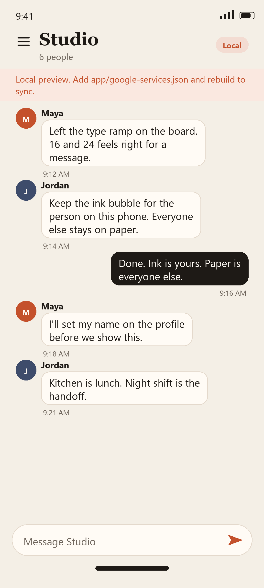
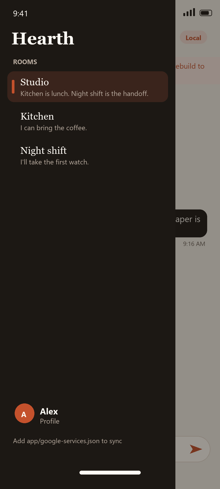
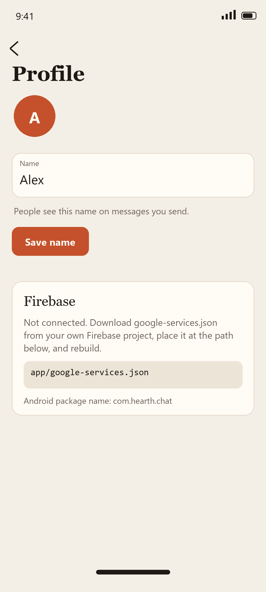

# Hearth

Hearth is a mobile chatting app for Android, built with Jetpack Compose. A phone opens rooms from the top bar. A wide window keeps the room list beside the conversation. The profile is where you set the name on messages you send.

The screen structure follows the [Jetchat](https://github.com/android/compose-samples/tree/main/Jetchat) sample: a conversation, a drawer of rooms, and a profile. Jetchat ships a fixed script of messages. Hearth writes each message to Cloud Firestore once you add your own Firebase config.

## Screenshots

| Conversation | Rooms | Profile |
| --- | --- | --- |
|  |  |  |

## Firebase

This repository does not include a Firebase project, an API key, or a `google-services.json` file. Create a project in the [Firebase console](https://console.firebase.google.com/), add an Android app, and turn on Cloud Firestore.

Use this package name when Firebase asks for it:

```
com.hearth.chat
```

Download `google-services.json` from that Android app and place it here:

```
app/google-services.json
```

`app/google-services.json.example` shows the shape of that file. It is not a working project. Do not rename the example and try to ship it. The real file is listed in `.gitignore`, so it stays on your machine.

Rebuild after the file is in place. Gradle applies the Google services plugin only when `app/google-services.json` exists, so the project still builds without it.

Without the file, Hearth keeps the conversation on the phone and labels the room **Local**. Those messages are not uploaded. With the file, the open room listens to this collection and a send writes a new document:

```
rooms/{roomId}/messages
```

Each document stores `authorId`, `authorName`, `body`, and `sentAt` (epoch milliseconds). The room ids in the app are `studio`, `kitchen`, and `night-shift`.

For a private demo, Firestore rules can allow read and write on that path:

```
rules_version = '2';
service cloud.firestore {
  match /databases/{database}/documents {
    match /rooms/{roomId}/messages/{messageId} {
      allow read, write: if true;
    }
  }
}
```

Lock those rules down before anyone else uses the project. Open rules are only for trying the demo yourself.

## What you can do

- Switch among Studio, Kitchen, and Night shift.
- Read a conversation, send a message, and jump back to the latest one.
- Set the name other people see.
- Use the light paper theme, or the dark theme that follows the system.

On a phone without `app/google-services.json`, the sample lines in each room are there so the interface can be tried before Firebase is connected.

## Project map

```
app/src/main/java/com/hearth/chat
  data/            rooms, messages, the local store, and Cloud Firestore
  ui/conversation  the open room and the message field
  ui/components    the room list
  ui/profile       name and Firebase setup
  ui/theme         paper, ink, and ember
```

The config path the app tells you to use is `FirebaseSetup.CONFIG_PATH` in `FirebaseSetup.kt`, which is `app/google-services.json`.

## Build

Open the project in Android Studio (JDK 17, Android SDK 35) and run the `app` configuration.

From a terminal, with `JAVA_HOME` pointed at a JDK 17 or newer:

```bash
./gradlew :app:assembleDebug
./gradlew :app:testDebugUnitTest
```

## License

Apache License 2.0. See [LICENSE](LICENSE) and [NOTICE](NOTICE).

The screen structure is inspired by Jetchat, Copyright 2020 The Android Open Source Project, also under the Apache License 2.0. Hearth's copy, theme, and Firebase wiring are separate from that sample.
